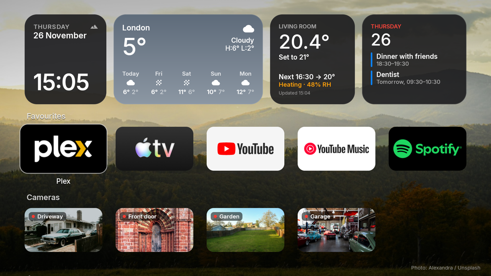
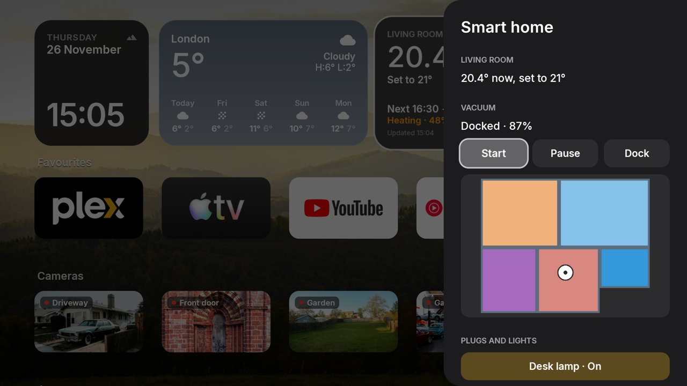
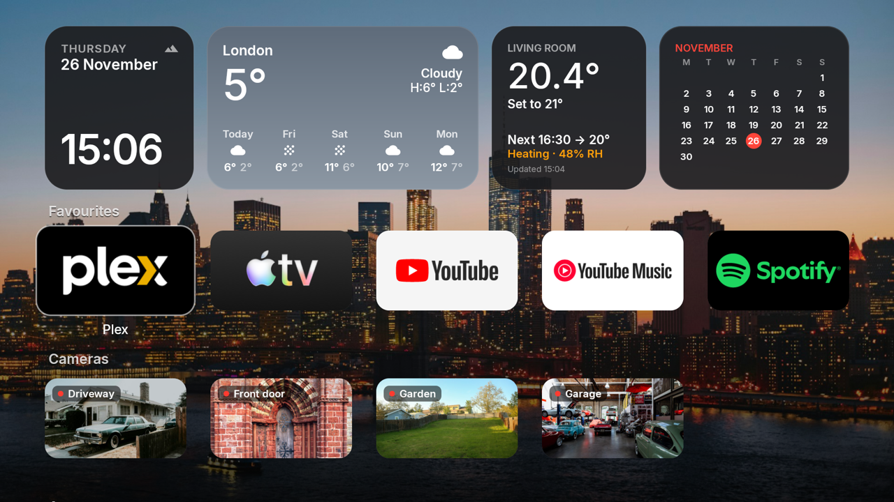

# TV Dashboard

A calm, ad-free home screen for Google TV, written in Kotlin with Compose for TV.

| Smart home panel | Plain calendar and your own wallpaper |
| --- | --- |
|  |  |

*Demo data throughout: the calendar entries, readings, floor plan and devices are made up, and the
camera pictures are stock photos. Photos from [Unsplash](https://unsplash.com) by Alexandra and
Luca Bravo (wallpapers), and Marius Christensen, Pix Tresa, Giorgio Trovato and Alex Suprun (cameras).*

## Features

- **Widgets:** clock, weather with a 5-day forecast, heating from [Home Assistant](#heating-from-home-assistant)
  or [Google Nest](#google-nest-thermostat-experimental) and a merged calendar from any number of iCal / webcal links
- **Wallpaper:** random photos from Unsplash
- **Apps:** a favourites row, every other app, and physical inputs on TVs that have them
- **Smart home panel:** vacuum, plugs and lights through Home Assistant
- **Cameras:** UniFi Protect (or any RTSP) stills on the home screen, live video full screen
- **Continue watching:** what you recently played on this device
- **Ambient mode:** select the clock to start Google's screensaver
- **Home button:** opens the dashboard instead of the Google TV home screen

Used on a Google TV Streamer and a TCL Google TV, both Android 14.

## Quick setup

One command. It needs nothing installed first.

**macOS or Linux** (Terminal):

    curl -fsSL https://tv.brwn.is/setup.sh | bash

**Windows** (PowerShell):

    irm https://tv.brwn.is/setup.ps1 | iex

It walks you through turning on Wireless debugging, asks for the TV's IP address, ports and
pairing code, builds your `config.json` (saved in the folder you run it from) from questions,
installs the latest release and switches it on. If `adb` is missing it offers to download it
from Google. Run it again to update.

To install your own build or reuse settings: `bash setup.sh --apk my.apk --config config.json`,
or on Windows set `$env:TVD_APK` and `$env:TVD_CONFIG` first.

Running a script straight from the internet means trusting it: you can download and read
[setup.sh](setup.sh) or [setup.ps1](setup.ps1) first.

## Install a release by hand

You need [`adb`](https://developer.android.com/tools/releases/platform-tools) on a Mac or Linux computer.

1. Download `tv-dashboard.apk`, `install.sh` and `config.example.json` from the
   [latest release](../../releases/latest).
2. On the TV, turn on Developer options and Wireless debugging, then `adb pair` and `adb connect`.
3. Copy `config.example.json` to `config.json`, edit it, and run:

       bash install.sh <tv-ip:port> tv-dashboard.apk config.json

To update, run the same command with the new APK and leave out `config.json`.
Installing the app switches on an accessibility service (see [Permissions](#permissions)).

## Requirements to build from source

- A Google TV / Android TV device (Android 9 or later) with Wireless debugging
- JDK 17, the Android SDK (platform 34) and `adb`. The deploy script is written for zsh.

## Build and install

1. Tell Gradle where the SDK is: set `ANDROID_HOME`, or add `sdk.dir=...` to `local.properties`.
2. On the TV, enable Developer options and Wireless debugging, then `adb pair` and `adb connect`.
3. Copy the example settings, edit them, and deploy:

       cp config.example.json config.json
       ./deploy.sh <tv-ip:port> --config config.json

4. For "Continue watching" (optional), allow notification access once:

       adb shell cmd notification allow_listener com.home.dashboard/com.home.dashboard.MediaListener

Builds are signed with your local Android debug key. Updating an installed app from another
computer needs the same key.

## Settings

`config.json` is imported into the app's private storage and is git-ignored. **Never commit it**:
it holds your API key and private links.

| Key | Meaning |
| --- | --- |
| `place`, `latitude`, `longitude` | Weather location |
| `location` | `"auto"` finds the location from your internet connection instead (via [geojs.io](https://www.geojs.io), which sees your public IP address) |
| `unsplashKey` | [Unsplash access key](https://unsplash.com/developers); without it you get a plain background |
| `unsplashQueries`, `wallpaperMinutes` | Photo themes and how often they change |
| `calendars` | `webcal://` or `https://` .ics links; without any, the widget shows this month |
| `cameras` | `name`, `url` (low quality, for tiles) and optional `hd` (full screen) |
| `snapshotSeconds` | How often camera stills refresh (default 15) |
| `favourites`, `hidden` | Package names to pin or hide |
| `homeAssistant` | Heating and the smart home panel through [Home Assistant](#heating-from-home-assistant) |
| `tado`, `tadoZone` | Or ask [tado](#heating-straight-from-tado) directly, and which room |
| `nest` | Or ask [Google Nest](#google-nest-thermostat-experimental) directly; written by `tools/nest-auth.py` |

**Cameras:** UniFi Protect `rtsps://…:7441` links are converted to Protect's plain RTSP port
7447, so video is unencrypted on your local network.

## Choosing where heating comes from

| Source | Set | Notes |
| --- | --- | --- |
| Home Assistant | `homeAssistant.climate` | Any thermostat it supports; also gives the smart home panel |
| tado directly | `"tado": true` | No server needed |
| Nest directly | `nest` | No server needed; experimental |

If more than one is set, Home Assistant wins, then Nest, then tado. Only that one is contacted.

## Heating straight from tado

Set `"tado": true` (and `tadoZone` for a particular room), deploy, then select the heating card
and approve the code in your browser. Accounts without a subscription get few API requests a
day, shared by all your devices, so readings can be 30 minutes old or more. Don't run this
alongside Home Assistant's tado integration unless you have allowance to spare.

## Heating from Home Assistant

The heating card reads a Home Assistant `climate` entity over the
[REST API](https://developers.home-assistant.io/docs/api/rest/), once a minute while the dashboard
is on screen. It works with any thermostat Home Assistant supports; it was built against the
tado° integration.

1. In Home Assistant, add a user for the TV (**Settings > People**) with **Administrator** off.
2. Sign in as that user, open its profile, and under **Security > Long-lived access tokens**
   create a token. It is shown once.
3. Add this to your `config.json`:

       "homeAssistant": {
         "url": "http://HOME_ASSISTANT_IP:8123",
         "token": "LONG_LIVED_ACCESS_TOKEN",
         "climate": "climate.living_room",
         "temperature": "sensor.living_room_temperature",
         "humidity": "sensor.living_room_humidity",
         "name": "Living Room"
       }

   `url` and `climate` must match your setup (find entity IDs under **Developer tools > States**).
   `temperature`, `humidity` and `name` are optional.
4. Deploy with that `config.json`.

If the address, token or climate entity is missing, the card says "Home Assistant not configured".
If a read fails, it keeps the last values and marks them stale. "Updated" is when Home Assistant
last heard the value (`last_reported`, or `last_updated` on older versions), not when the TV
asked.

The token lives only in `config.json` (git-ignored) and the app's private storage; it is not built
into the APK. Anyone who has it can control your Home Assistant as that user, and over plain
`http` it crosses your network unencrypted.

### Smart home panel

Add any of these to `homeAssistant` and select the heating card to open a panel with your
vacuum (start, pause, dock) and on/off buttons for plugs and lights:

    "vacuum": "vacuum.robot",
    "battery": "sensor.robot_battery",
    "devices": [{"name": "Lamp", "entity": "light.lamp"}],
    "maps": ["image.robot_downstairs", "image.robot_upstairs"],
    "mapSelect": "select.robot_selected_map"

`maps` shows the vacuum's map in the panel (the Roborock integration provides these `image`
entities). With `mapSelect`, the floor the vacuum has selected is shown. Heating is read-only. The TV only sends commands to the entities listed here, and only
`light`, `switch`, `fan` and `input_boolean` devices. That is a limit of the app, not of the
token, which can do whatever its Home Assistant user can.

### Next scheduled change (tado, experimental)

> **Not yet tried against a real tado account.** For tado V2/V3; tado X is not supported.

Home Assistant's tado integration doesn't publish the schedule, so `tools/tado-schedule.py`
fetches it, at most once every 7 days (a few API calls the first time, then two a week).

1. Copy the script to `/config/tado_schedule/` on Home Assistant.
2. From a Home Assistant terminal, sign in once:
   `python3 /config/tado_schedule/tado-schedule.py login`
3. Add to `configuration.yaml`, then restart:

       command_line:
         - sensor:
             name: Tado living room schedule
             command: "python3 /config/tado_schedule/tado-schedule.py --zone 'Living Room'"
             value_template: "{{ value_json.fetched }}"
             json_attributes: [schedule, zone]
             scan_interval: 3600
             command_timeout: 30

   The hourly run only reads the script's cache until a week has passed.
4. Add `"schedule": "sensor.tado_living_room_schedule"` to `homeAssistant` in `config.json`.

After changing your schedule in tado, run the script with `--force` (and the same `--zone`).
The folder holds a tado sign-in and is included in Home Assistant backups: keep both private.

## Google Nest thermostat (experimental)

> **Untested on real hardware.** Written from Google's documentation; reports and fixes are welcome.

Shows current temperature, target and eco mode. It is read-only.

You need your own credentials:

1. Register for [Device Access](https://developers.google.com/nest/device-access/registration)
   with the Google account that owns the thermostat. Google charges a one-off US$5.
2. In [Google Cloud](https://console.cloud.google.com), create a project, enable the **Smart Device
   Management API**, and create an OAuth client of type **Web application** with the redirect URI
   `https://www.google.com`.
3. On the OAuth consent screen, add the `https://www.googleapis.com/auth/sdm.service` scope and
   **publish the app to production**. Left in testing, sign-ins can stop working after 7 days.
4. In the [Device Access console](https://console.nest.google.com/device-access), create a project
   using that OAuth client ID. Note the project ID.
5. On your computer, run `python3 tools/nest-auth.py config.json` and follow the prompts.
6. Deploy with the updated `config.json`. Set `nest.room` to choose between several thermostats.

See Google's [authorisation guide](https://developers.google.com/nest/device-access/authorize).
The secret and token are stored in `config.json` and the app's private storage: keep them private.

## Permissions

| Permission | Why |
| --- | --- |
| Accessibility service | Catches the Home button, and presses "Start now" after you select the clock. Android sends it all remote key presses; it acts only on Home and passes the rest through. |
| Notification access (optional) | Reads media sessions for "Continue watching". It opts out of receiving notifications. |

## Known limits

- Some TVs (TCL, for one) block auto-start, so after a restart Google TV's home returns. Run
  `NO_INSTALL=1 ./deploy.sh <tv-ip:port>`, or use the [watchdog container](watchdog/).
- "Continue watching" only knows what apps report. Some give no artwork or episode number, and
  selecting a card opens the app, not the episode.
- On modest TV graphics chips, keep full-screen blending to a minimum: it is why the wallpaper
  gradient is baked into the photo and camera tiles are stills.

## Extras

- [Debloating a TCL Google TV](docs/debloat-tcl.md)

## Credits

Weather data by [Open-Meteo](https://open-meteo.com) (CC BY 4.0). Photos from
[Unsplash](https://unsplash.com). Font: [Inter](https://github.com/rsms/inter), under the
[SIL Open Font License](licenses/Inter-OFL.txt).

Not affiliated with Google, Apple, TCL, Ubiquiti, Plex, tado° or Unsplash.

## Licence

[MIT](LICENSE)
